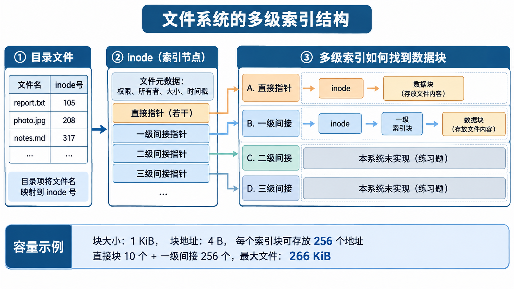

# 设计说明

本文按照从下到上的顺序介绍文件系统的每一层，最后用两个完整的例子串起来。阅读时建议对照 `src/` 下的源码。

## 1. 磁盘：一切从"块"开始

真实的磁盘只能整块读写。我们用一个普通文件模拟磁盘，`src/disk.c` 只提供两个操作：

```c
void disk_read(uint32_t bno, void *buf);        /* 读第 bno 块 */
void disk_write(uint32_t bno, const void *buf); /* 写第 bno 块 */
```

上层的所有代码都只能通过这两个函数访问磁盘。几个细节：

- 打开镜像文件时**必须使用二进制模式**（`"r+b"`）。在 Windows 上，文本模式会把字节 `0x0A` 改写成 `0x0D 0x0A`，镜像就被破坏了，旧版本正是因此出错。
- 每次 `disk_write` 之后都会调用 `fflush`，也就是**直写（write-through）**：数据立刻写到宿主机文件，程序被强制结束也不会丢失已完成的操作。代价是速度慢，加上块缓存是一个很好的扩展练习。
- 读写失败时会调用 `panic` 直接退出。磁盘出错时，文件系统已无法保证正确，真实内核也是这样处理的。

## 2. 磁盘布局

镜像大小为 1024 块 × 1024 字节 = 1 MiB，布局固定：

| 块号 | 内容 | 说明 |
| --- | --- | --- |
| 0 | 超级块 `superblock_t` | 魔数和各区域的位置。挂载时逐项比对，不一致就拒绝挂载 |
| 1 | 位示图 | 1024 位，每位对应一块 |
| 2 | 用户表 | 16 个 `user_t` |
| 3 – 10 | inode 表 | 128 个 64 字节的 inode，每块存 16 个 |
| 11 – 1023 | 数据块 | 文件内容、目录内容、间接块都放在这里 |

所有常量都定义在 `src/fs.h` 中。结构体直接按内存布局写入磁盘，因此每个结构体的大小都用 `_Static_assert` 固定下来。例如往 `inode_t` 加了一个字段，编译器会立刻提示大小不再是 64 字节。这比旧版本手写 `#define FILESIZE 280`（注释里却写着 288）要可靠得多。

> 注意：结构体按本机字节序写入，所以镜像不能在大端和小端机器之间直接交换。常见的 x86 和 ARM 机器都是小端，不受影响。

## 3. 位示图：数据块的分配

`src/bitmap.c`：

- `balloc()` 从第 `DATA_START` 块开始找第一个为 0 的位，把它置 1，**把新块清零**，然后返回块号。清零是为了避免新文件读到上一个文件留下的内容。
- `bfree(b)` 把对应位清 0。如果释放的是元数据块或已经空闲的块，就直接 `panic`。这类检查能让 bug 尽早暴露，而不是悄悄把磁盘写坏。
- 返回 0 表示"没有空闲块"。0 号块是超级块，永远不会被分配，所以可以用 0 作为失败标记。inode 号 0 也采用同样的约定。

## 4. inode：文件的元数据

```c
typedef struct {
    uint16_t type;                 /* T_FREE / T_DIR / T_FILE */
    uint16_t mode;                 /* 权限，如 0755 */
    uint16_t uid, gid;             /* 所有者、所属组 */
    uint32_t size;                 /* 字节数 */
    uint32_t ctime, mtime;         /* 创建、修改时间 */
    uint32_t direct[NDIRECT];      /* 10 个直接块号 */
    uint32_t indirect;             /* 一级间接块号 */
} inode_t;                         /* 64 字节 */
```

inode 中**没有文件名**，文件名保存在目录里（见第 5 节）。`type == T_FREE` 表示这个 inode 空闲，所以不需要单独的 inode 位示图。

### 4.1 混合索引

文件内容按 1 KiB 切成逻辑块。第 n 个逻辑块存放在哪个磁盘块，由 `bmap()` 计算：

```text
           inode
        +-----------+
        | direct[0] | ------------------------> 数据块（文件第 0 KiB）
        |    ...    |
        | direct[9] | ------------------------> 数据块（文件第 9 KiB）
        | indirect  | ---> 间接块 +---------+
        +-----------+             | [0]     | --> 数据块（第 10 KiB）
                                  | ...     |
                                  | [255]   | --> 数据块（第 265 KiB）
                                  +---------+
```

- 逻辑块 0–9：直接块，读取 inode 后就能拿到块号。
- 逻辑块 10–265：先读间接块（一个间接块存 1024 / 4 = 256 个块号），再找到数据块。
- 最大文件大小为 (10 + 256) × 1 KiB = **266 KiB**。



`bmap(ip, n, alloc)` 在 `alloc` 为真时会按需分配缺少的数据块和间接块。写文件时传 1，读文件时传 0。读到未分配的块（称为"空洞"）时返回全 0。

用 `stat` 可以直接看到这些块号：

```text
Direct: 12 13 14 15 16 17 18 19 20 21
Indirect: block 22 (16 of 256 entries used)
```

### 4.2 按字节读写：readi / writei

上层不关心块的划分，只需要调用"从第 off 字节起读写 n 字节"：

```c
int readi(uint32_t inum, void *dst, uint32_t off, uint32_t n);
int writei(uint32_t inum, const void *src, uint32_t off, uint32_t n);
```

`writei` 的循环每次处理一个块。如果只修改块的一部分，就要先把这块读出来，改完再整块写回，这叫"读-改-写"。写完后，如果写到了原文件末尾之后，就更新 `size`，并且**必须把 inode 写回磁盘**，因为 `bmap` 可能刚刚分配了新的块号。

`itrunc()` 释放一个文件的所有数据块，包括间接块本身以及它指向的所有块。`ifree()` 在 `itrunc()` 之后再把 inode 清空。旧版本删除文件时只回收了索引块，覆盖写时也不释放旧块，这就是块泄漏。测试脚本会在"写入后再删除"前后比较 `df` 的输出，专门检查这一点。

## 5. 目录

目录也是文件（`type == T_DIR`），它的内容是一串 32 字节的目录项：

```c
typedef struct {
    uint32_t inum;        /* 0 表示空槽 */
    char     name[28];    /* 最多 27 字节 + '\0' */
} dirent_t;
```

例如 `/docs` 目录的内容可能是这样：

| inum | name |
| --- | --- |
| 2 | `.` |
| 1 | `..` |
| 3 | `hello.txt` |
| 0 | （已删除的空槽） |
| 5 | `notes` |

- `dir_lookup`：顺序扫描，找到名字相同的项。
- `dir_link`：优先复用空槽，没有空槽就追加到目录末尾。目录会像普通文件一样自动增长，不受"一个块最多 14 项"之类的限制。
- `dir_unlink`：把对应槽位清零，不移动其他项，所以 `rm -r` 可以一边遍历一边删除。

### 为什么不把元数据存在目录项里？

旧版本把完整的 `file_` 结构体存放在父目录里，同时又在自己的 `.` 项和每个子目录的 `..` 项里各存一份副本。这样一来，只要修改了一个目录，就得同步"祖父目录中的项、自己的 `.` 项、所有子目录的 `..` 项"。漏掉任何一处，数据就会不一致，旧版本的大部分 bug 都由此而来。

现在元数据**只在 inode 中存一份**，目录项只记录 inode 号。修改文件属性只需要写一次 inode，不需要任何同步。这也是 Unix 系列文件系统（ext2、xv6 等）的标准做法。

## 6. 路径解析

`fs_lookup(s, path, &inum)`（位于 `src/fsops.c`）的处理过程：

1. 如果 `path` 以 `/` 开头，从根目录（inode 1）开始；否则从当前目录 `s->cwd` 开始。
2. 按 `/` 把路径切成若干段，每一段都在当前目录中执行 `dir_lookup`。`.` 和 `..` 本身就是普通的目录项，不需要特殊处理。
3. 每经过一级目录，都要检查它是否是目录（否则返回 `E_NOTDIR`），以及是否有 `x` 权限（否则返回 `E_ACCES`）。

切分路径时**不使用 `strtok`**。`strtok` 会原地修改传入的字符串，还依赖隐藏的全局状态。旧版本把当前目录的路径直接交给 `strtok`，结果把它写坏了，所以无法在子目录里创建文件。

创建和删除操作需要的是"父目录 + 最后一级名字"，由 `lookup_parent()` 拆分。例如 `a/b/c` 会拆成目录 `a/b` 和名字 `c`。

`pwd` 不保存路径字符串，而是从当前目录出发沿 `..` 一直走到根目录，在每一级父目录里反查自己的名字，再拼接起来。

## 7. 用户与权限

- 用户表保存在一个块中，**uid 就是用户在表中的下标**。删除用户只是把槽位标记为未用，其他用户的 uid 保持不变。旧版本删除用户时会把后面的用户整体前移，导致文件的所有者错位。
- 组固定为三个：`root(0)`、`staff(1)`、`guest(2)`。
- 删除用户时，`fs_reassign_owner` 会把该用户名下的所有文件转给 root。

权限检查和 Unix 一致：

```c
if (uid == 0)            允许一切
else if (uid == 所有者)   看 mode 的 6~8 位
else if (gid == 所属组)   看 mode 的 3~5 位
else                     看 mode 的 0~2 位
```

| 操作 | 需要的权限 |
| --- | --- |
| `cat` | 文件的 r |
| `write`、`append` | 文件的 w |
| `ls` | 目录的 r |
| `cd`，以及路径中经过的每一级目录 | 目录的 x |
| 在目录中创建或删除 | 父目录的 w 和 x |
| `chmod` | 必须是所有者或 root |

新建目录的权限是 `0755`，新建文件的权限是 `0644`。

> 密码以明文保存在镜像中，只是为了演示。真实系统会保存加盐哈希。

## 8. 错误处理

所有函数失败时都返回负数错误码（定义在 `src/fs.h` 中，例如 `E_NOENT`、`E_ACCES`），成功时返回 `FS_OK`（0）。命令行层统一用 `fs_strerror()` 把错误码转成提示信息，例如 `rm: directory not empty (use rm -r)`。

操作中途失败时要**回滚**。以 `create_node` 为例：如果已经分配了 inode，但往父目录添加目录项时失败了，就要用 `ifree` 把这个 inode 还回去，不能留下一个无人引用的 inode。

## 9. 两个完整的例子

### 9.1 `write /docs/a.txt`，内容为 3000 字节

1. 命令行先调用 `fs_open` 检查目标：不存在没关系，但如果是目录或者没有写权限，就立即报错，免得用户白白输入一大段文字。
2. 读入文本，直到遇到单独一行 `.`。
3. `fs_write` 调用 `fs_lookup("/docs/a.txt")`，得到 `E_NOENT`，于是调用 `create_node`：
   - `lookup_parent` 拆分出父目录 `/docs` 和名字 `a.txt`；
   - 检查父目录的 w 和 x 权限，并确认没有重名；
   - `ialloc` 找到一个空闲 inode，填入类型、权限、所有者和时间；
   - `dir_link` 在 `/docs` 的内容中写入目录项 `{inum, "a.txt"}`。
4. `writei(inum, data, 0, 3000)` 每次处理一块，共循环 3 次：
   - `bmap(.., 0, 1)` 发现 `direct[0] == 0`，于是调用 `balloc()` 分配一块，写入 1024 字节；
   - 逻辑块 1 同理；
   - 逻辑块 2 只写 952 字节，所以先读出这一块，改完再写回。
5. 把 `size` 设为 3000，并把 inode 写回 inode 表。

整个过程会有几十次块读写（ialloc 逐个扫描 inode 也要读盘）。每一次写都已经落盘，所以运行 `stat /docs/a.txt` 就能看到 3 个直接块。

### 9.2 `rm -r /docs`

1. `fs_lookup` 找到 `/docs` 的 inode。如果它是根目录，或者是当前目录本身及其祖先，就返回 `E_BUSY`，因为不能删掉自己"脚下"的目录。
2. `remove_entry` 发现目录非空，于是递归删除其中的每一项（跳过 `.` 和 `..`）。
3. 对于每个文件和目录：调用 `dir_unlink` 从父目录中删除目录项，再调用 `ifree` 释放全部数据块（包括间接块）并清空 inode。
4. 最后删除 `/docs` 自身。完成后，`df` 的数字会回到创建 `/docs` 之前的值。

## 10. 已知的简化

为了让代码保持在课堂可以读完的规模，这个文件系统省略了下面这些机制。它们也正是 [exercises.md](exercises.md) 中的练习题：

- 没有块缓存，每次访问都直接读写磁盘；
- 没有日志，如果在一次操作的多次块写之间断电，磁盘可能处于不一致的状态；
- 没有硬链接、重命名和打开文件表；
- 只有一级间接索引；
- 同一时间只有一个用户在操作，没有并发控制。
